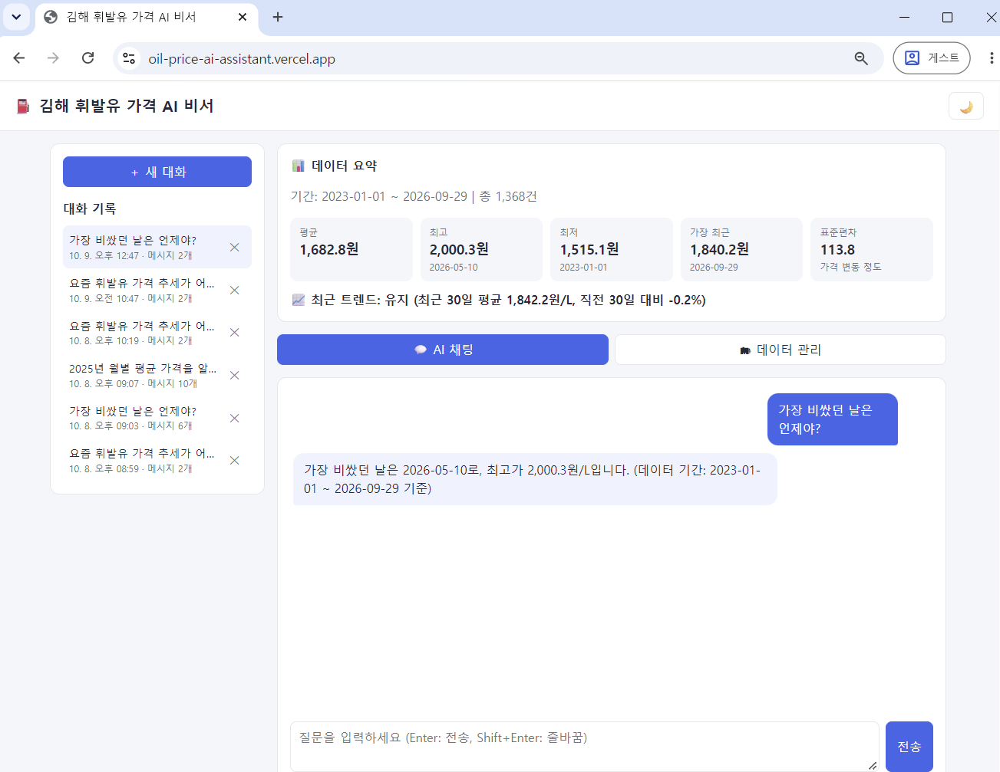
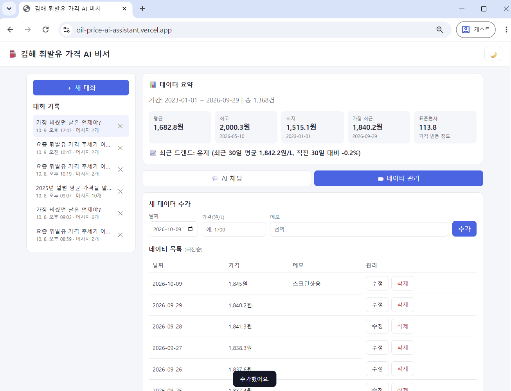
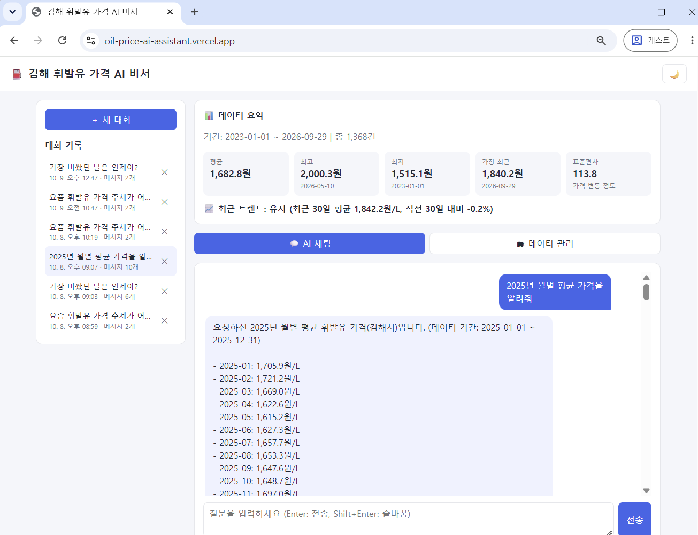
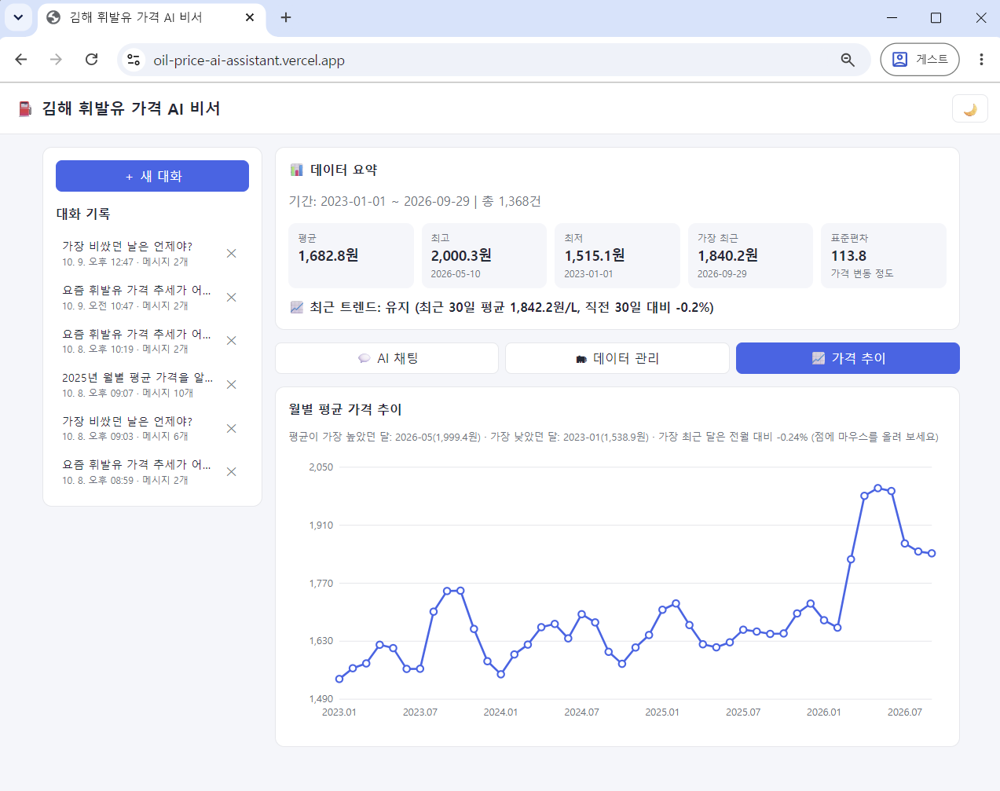

# ⛽ 김해 휘발유 가격 AI 비서

내 데이터를 이해하고 답하는 AI 서비스입니다. 김해시 휘발유 가격 시계열 데이터(2023-01-01 ~ 2026-09-29, 1,368일)를 분석해 요약 정보를 만들고, AI가 이 요약을 근거로 질문에 답합니다.

> 일반적인 챗봇은 내 데이터를 모릅니다. 이 서비스는 **데이터 요약을 시스템 프롬프트에 주입(컨텍스트 주입)** 해서 "지금 가격 추세가 어때?", "가장 비쌌던 날은 언제야?" 같은 질문에 실제 데이터로 답합니다.

## 주요 기능

| 기능 | 설명 |
|---|---|
| 데이터 기반 AI 채팅 | 질문 → 데이터 요약 주입 → GPT 호출 → 답변 (로딩 표시 포함) |
| 데이터 관리 (CRUD) | 날짜·가격·메모를 추가 / 조회 / 수정 / 삭제 |
| 대화 기록 | 대화 자동 저장, 목록 조회, 이전 대화 불러오기, 삭제 |
| 데이터 요약 | 기간, 건수, 평균·최고·최저·최근 가격, 표준편차, 최근 30일 트렌드 |
| 가격 추이 그래프 | 월별 평균 가격 꺾은선 그래프 (점에 마우스를 올리면 평균·최저·최고·전월 대비 변동률 표시) |
| 데이터 내보내기 | 전체 데이터를 CSV 또는 JSON 파일로 다운로드 |
| 다크 모드 | 화면 오른쪽 위 토글 |

## 기술 스택

| 영역 | 사용 기술 |
|---|---|
| 백엔드 | Python, FastAPI, Uvicorn, Pydantic |
| 데이터베이스 | Firebase Firestore (`data`, `conversations` 컬렉션) |
| AI | OpenAI 호환 API (`openai` SDK, Function Calling) |
| 프론트엔드 | HTML, CSS, JavaScript (프레임워크 없음) |
| 배포 | 백엔드: Render / 프론트엔드: Vercel |

## 데이터

이 서비스가 분석하는 김해시 휘발유 가격 데이터의 출처와 가공 방법입니다.

| 항목 | 내용 |
|---|---|
| 출처 | 한국석유공사 **오피넷(Opinet)** "유가내려받기" 서비스 (https://www.opinet.co.kr) |
| 대상 | 경남 김해시, 휘발유 |
| 기간 | 2023-01-01 ~ 2026-09-29 (일별, 1,368일. 빠진 날짜 없음) |
| 단위 | 원/L |
| 수집 방법 | 오피넷에서 지역·유종·기간을 지정해 연도별 CSV를 직접 다운로드 |
| 가공 | 연도별 원본 파일을 합친 뒤 날짜별 평균으로 1차 정제 → 최종 파일 `date, value, memo` (`backend/data/gimhae_gasoline_final.csv`) |

- `date`, `value`는 위 방법으로 만든 날짜별 가격이며, 서버는 이 값으로만 요약·통계·AI 답변을 만듭니다.
- 데이터는 **정적 스냅샷**입니다. (자동 수집 없음, 마지막 날짜 2026-09-29) 시간이 지나면 "최근 트렌드"는 낡은 값이 되지만, AI는 오늘 날짜와 데이터의 마지막 날짜를 함께 받아서 "이번 달" 같은 질문에는 그 기간의 데이터가 아직 없다고 먼저 안내합니다.
- `memo`는 일부 날짜에 붙여 둔 설명 메모입니다. **AI에는 전달되지 않으며**(AI는 날짜와 가격만 근거로 답합니다), 데이터 관리 화면과 CSV/JSON 내보내기에서만 확인할 수 있습니다.

## 배포 URL

| 구분 | 주소 |
|---|---|
| 프론트엔드 (Vercel) | https://oil-price-ai-assistant.vercel.app |
| 백엔드 API (Render) | https://oil-price-ai-assistant.onrender.com |
| Swagger UI | https://oil-price-ai-assistant.onrender.com/docs |

> ⏳ **무료 서버 안내**: 백엔드는 Render 무료 플랜이라 한동안 접속이 없으면 잠들고, 첫 요청에 **최대 1분** 정도 걸릴 수 있습니다. 화면에는 응답이 4초 넘게 걸리면 "서버를 깨우는 중이에요" 안내가 표시됩니다. 한 번 깨어난 뒤에는 빠르게 응답합니다.

## 스크린샷

**1. 데이터 요약이 보이는 채팅 화면**



**2. 데이터 관리 화면 (데이터 추가)**



**3. 대화 기록 화면 (이전 대화 불러오기)**



**4. 가격 추이 그래프 (보너스)**



## 동작 원리

### 컨텍스트 주입 (데이터 요약 → 시스템 프롬프트)

```
사용자 질문
   │
   ▼
POST /api/chat
   ├─ ① (이어가는 대화면) conversations에서 이전 대화 불러오기
   ├─ ② 데이터 요약 계산 (기간 / 건수 / 지표 / 트렌드)
   ├─ ③ 요약을 시스템 프롬프트에 삽입
   ├─ ④ GPT 호출
   └─ ⑤ 질문·답변을 conversations에 자동 저장
```

#### 요약 → 프롬프트 (실제 예시)

`GET /api/data/summary`의 실제 응답입니다. (운영 서버에서 2026-10-10에 확인한 값. 과제의 `period / count / metrics / trend` 구조와 같습니다.)

```json
{
  "period": "2023-01-01 ~ 2026-09-29",
  "count": 1368,
  "metrics": {
    "average": 1682.78,
    "max": 2000.3,
    "max_date": "2026-05-10",
    "min": 1515.1,
    "min_date": "2023-01-01",
    "latest": 1840.2,
    "latest_date": "2026-09-29",
    "std_dev": 113.84,
    "recent_30d_avg": 1842.22
  },
  "trend": "유지 (최근 30일 평균 1,842.2원/L, 직전 30일 대비 -0.2%)"
}
```

이 응답이 아래처럼 시스템 프롬프트의 `[사용자 데이터 요약]` 부분으로 바뀌어 AI에 전달됩니다. (아래는 코드가 실제로 만든 프롬프트이고, 오늘 날짜는 예시를 만든 2026-10-10으로 고정했습니다.) (`services/ai_service.py`의 `_summary_text()`, `_system_prompt()`)

```
당신은 경상남도 김해시의 휘발유 가격 데이터를 분석해 주는 AI 비서입니다.
오늘 날짜: 2026-10-10 (한국 시간 기준)
데이터의 마지막 날짜는 2026-09-29이며(오늘보다 11일 전), 그 이후의 데이터는 없습니다.

[사용자 데이터 요약]
- 데이터 기간: 2023-01-01 ~ 2026-09-29
- 총 레코드: 1368개 (하루 1건, 단위: 원/L)
- 주요 지표: 평균 1,682.8원, 최고 2,000.3원(2026-05-10), 최저 1,515.1원(2023-01-01), 가장 최근 1,840.2원(2026-09-29), 표준편차 113.8
- 최근 트렌드: 유지 (최근 30일 평균 1,842.2원/L, 직전 30일 대비 -0.2%)

규칙:
1. 위 요약을 기본 근거로 맞춤형 답변을 하세요. 요약에 없는 세부 값(특정 날짜의 가격, 특정 기간의 평균, 월별 추이 등)은 제공된 도구로 조회한 뒤 답하세요. 기억이나 추측으로 숫자를 말하지 마세요.
2. '올해', '지난달', '최근'처럼 상대적인 기간은 오늘 날짜 기준으로 계산해 YYYY-MM-DD로 바꿔서 도구에 전달하세요.
3. 보유 데이터 기간 밖의 질문이면 보유 기간을 안내하고, 해당 기간은 답할 수 없다고 말하세요.
4. 한국어로 간결하고 친절하게 답하세요. 가격은 '1,700.5원/L'처럼 천 단위 쉼표와 단위를 붙이세요.
5. 휘발유 가격과 무관한 질문에는 정중하게 답변 가능한 범위를 안내하세요.
6. 가격 전망이나 주유 시점을 단정하지 말고, 과거 데이터에 근거한 참고 의견임을 밝히세요.
7. 데이터의 마지막 날짜 이후에 해당하는 기간(예: '오늘', '이번 주', '이번 달')을 물으면, 그 기간의 데이터는 아직 없다고 먼저 알리고, 가장 최근 데이터로 대신 답하면서 기준 날짜를 밝히세요.
8. 마크다운 문법(**, #, 표 등)은 쓰지 말고 일반 문장과 줄바꿈으로만 답하세요.
```

| 요약 응답 | 프롬프트에서 대응하는 줄 |
|---|---|
| (서버가 계산) 오늘 날짜(한국 시간), 마지막 날짜와의 간격 | 맨 위의 `오늘 날짜`, `데이터의 마지막 날짜` 줄 |
| `period` | 데이터 기간 |
| `count` | 총 레코드 |
| `metrics` (`average`, `max`, `min`, `latest`, `std_dev`) | 주요 지표 |
| `trend` (`recent_30d_avg`가 문장 안에 포함됨) | 최근 트렌드 |

`[사용자 데이터 요약]`은 데이터가 바뀔 때마다 새로 계산되어 들어갑니다. (추가·수정·삭제하면 캐시도 그 한 건만 바로 고쳐집니다.)

트렌드는 **최근 30일 평균과 직전 30일 평균을 비교**해 ±0.5% 이상이면 상승/하락, 그 안이면 유지로 판단합니다.

### 추가 구현: AI 도구 호출 (Function Calling)

요약만으로 답할 수 없는 세부 질문(특정 기간의 평균, 월별 추이 등)은 AI가 필요한 도구를 직접 호출해 데이터를 조회한 뒤 답합니다.

| 도구 | 용도 |
|---|---|
| `get_price_stats` | 기간의 평균·최고·최저·변동폭 |
| `get_prices` | 짧은 기간의 일별 가격 (최대 60건) |
| `get_monthly_averages` | 월별 평균 (긴 기간의 추세) |

호출 흐름: ① 질문과 요약을 GPT에 전달 → ② 요약으로 부족하면 GPT가 도구 호출을 요청 → ③ 서버가 Firestore 데이터를 조회해 결과 전달 → ④ GPT가 결과를 근거로 최종 답변 (최대 5회 반복). 어떤 도구를 어떤 인자로 호출했는지는 `/api/chat` 응답의 `tool_calls`(도구 이름과 인자), `tools_used`(도구 이름), 채팅 화면의 "🔧 추가 조회: get_price_stats(start_date=…, end_date=…)" 표시, 서버 로그의 `도구 호출:` 줄에서 확인할 수 있습니다. 이 정보는 대화와 함께 저장되어 이전 대화를 다시 불러와도 표시됩니다.

### 추가 구현: 시각화와 내보내기

- **추가 지표**: 요약에 표준편차(가격 변동 정도)와 최근 30일 평균을 추가했고, 월별 통계에는 전월 대비 변동률을 제공합니다.
- **그래프**: 외부 라이브러리 없이 SVG를 직접 그려 월별 평균 추이를 보여 줍니다. 색상을 CSS 변수로 지정해 다크 모드에서도 자동으로 바뀝니다.
- **내보내기**: 서버가 `Content-Disposition: attachment` 헤더로 응답하므로 버튼을 누르면 바로 파일이 내려받아집니다. CSV는 맨 앞에 BOM을 넣어 엑셀에서 한글 메모가 깨지지 않습니다.
- 통계와 내보내기도 메모리 캐시를 사용하므로 Firestore 읽기를 추가로 소모하지 않습니다.

### 비용 절약 (Firestore 읽기 캐시)

Firestore는 읽은 문서 수만큼 무료 한도가 줄어듭니다. 전체 데이터(1,368건)를 서버 메모리에 한 번 읽어 두고, 조회(요약·통계·목록·내보내기·AI 도구)는 **모두 이 캐시에서 처리**합니다. 데이터를 추가·수정·삭제하면 Firestore에 쓰면서 캐시도 **그 한 건만** 바로 고치므로 전체를 다시 읽지 않고, Firestore를 직접 고친 경우(콘솔, 적재 스크립트)를 반영하기 위해 6시간마다 한 번만 전체를 다시 읽습니다.

- 예전에는 목록 조회(`GET /api/data?limit=2000`)가 호출할 때마다 Firestore를 직접 읽어서, 약 25번만 호출해도 하루 무료 읽기 한도(5만 건)가 소진될 수 있었습니다. 지금은 캐시에서 만들기 때문에 읽기가 늘지 않습니다.
- 서버가 슬립에서 깨어난 직후 첫 요청은 캐시를 채우느라 1,368건을 읽습니다. 하루 한도 기준으로 약 36번의 기상까지 견디며, 이 한계는 아래 "알려진 한계"에 적었습니다.

### 토큰·비용 제한 (OpenAI 과금 주의)

AI 호출에서 토큰(=비용)이 불필요하게 늘어나지 않도록 아래 제한을 두었습니다.

| 제한 | 값 | 효과 |
|---|---|---|
| 데이터 전체 대신 **요약만 주입** | 수백 토큰 분량의 요약 몇 줄 | 1,368건 전체를 프롬프트에 넣지 않아 입력 토큰을 크게 절약 |
| 질문 길이 | 최대 1,000자 (Pydantic 검증) | 지나치게 긴 입력 차단 |
| 이어가는 대화 | 최근 10개 메시지만 AI에 전달 | 대화가 길어져도 입력 토큰이 무한히 늘지 않음 (전체 기록은 DB에 저장) |
| 도구 호출 횟수 | 한 질문당 최대 5회 | 도구 호출이 반복되는 상황 방지 |
| 도구 조회 결과 크기 | 일별 목록 최대 60건, 긴 기간은 월별 평균으로 요약 | 도구 결과가 커져 토큰이 늘어나는 것 방지 |
| 답변 길이 | 시스템 프롬프트에서 "간결하게 답변"을 지시 | 출력 토큰 절약 |
| **출력 토큰 상한** | 호출 1회당 `max_completion_tokens` 4,000 (환경 변수로 조정 가능. 단 **0 이하는 허용하지 않고** 기본값이 적용됨) | gpt-5 계열은 추론 토큰도 상한에 포함되므로 여유 있게 설정. 상한에 걸려 답이 끊기면 안내 문구를 함께 반환 |
| **응답 대기 시간** | OpenAI 호출 timeout 60초, 재시도 1회 | AI 서버가 응답하지 않을 때 무한정 기다리거나 비용이 늘어나는 것을 방지 |
| **질문 횟수 제한** | 서버 전체 합산 분당 20회 / 하루 300회 (초과 시 `429`) | 누군가 반복 호출해도 AI 비용이 무한히 늘지 않도록 상한을 둠. 한계는 아래 "보안과 알려진 한계" 참고 |

실제 토큰 사용량은 호출마다 서버 로그(`토큰 사용: prompt=… completion=… (추론=…)`)에 기록되므로, 이 값을 보고 `OPENAI_MAX_COMPLETION_TOKENS`를 조정할 수 있습니다. (gpt-5 계열은 추론 토큰도 이 상한에 포함됩니다.)

개발·테스트 단계에서는 작은 질문 위주로 검증했으며, 요약 응답이 캐시되어 있어 같은 요약을 만들기 위해 DB를 반복해서 읽지도 않습니다.

## API 목록

Swagger UI(`/docs`)에서 직접 호출해 볼 수 있습니다.

| 메서드 | 경로 | 설명 |
|---|---|---|
| POST | `/api/data` | 새 데이터 추가 (같은 날짜는 409) |
| GET | `/api/data` | 목록 조회 (`start_date`, `end_date`, `order`, `limit`, `offset`) |
| PUT | `/api/data/{id}` | 데이터 수정 (보낸 필드만 변경) |
| DELETE | `/api/data/{id}` | 데이터 삭제 |
| GET | `/api/data/summary` | 데이터 요약 (프롬프트 주입용) |
| GET | `/api/data/statistics` | 월별 통계: 평균·최저·최고·전월 대비 변동률 (그래프용) |
| GET | `/api/data/export` | 데이터 내려받기 (`format=csv` 또는 `json`, 기간 필터 가능) |
| POST | `/api/chat` | AI 대화 (`message`, 선택 `conversation_id`) |
| POST | `/api/conversations` | 대화 저장 |
| GET | `/api/conversations` | 대화 목록 (본문 대신 `message_count` 포함) |
| GET | `/api/conversations/{id}` | 특정 대화의 전체 메시지 조회 |
| DELETE | `/api/conversations/{id}` | 대화 삭제 |

입력 값은 Pydantic으로 검증합니다. (날짜는 `YYYY-MM-DD` 형식, 가격은 0보다 큰 값, 질문은 1~1000자)

## 폴더 구조

```
.
├── backend/
│   ├── main.py                  # FastAPI 앱, CORS, 라우터 등록
│   ├── config.py                # 환경 변수 읽기
│   ├── firebase_client.py       # Firestore 연결
│   ├── schemas.py               # Pydantic 모델 (요청/응답 검증)
│   ├── routers/                 # data.py, chat.py, conversations.py
│   ├── services/                # data_service.py(요약·캐시), ai_service.py, conversation_service.py
│   ├── scripts/                 # load_data.py(CSV → Firestore 적재), check_duplicates.py, test_llm.py
│   ├── data/                    # gimhae_gasoline_final.csv (원본 데이터)
│   ├── tests/                   # pytest 테스트 (스키마 검증, 요약 계산, API, 채팅/대화 기록)
│   ├── requirements.txt         # 서버 실행에 필요한 패키지 (버전 고정)
│   └── requirements-dev.txt     # 테스트용 패키지 (pytest 등)
├── frontend/                    # index.html, style.css, app.js, config.js
└── .env.example                 # 환경 변수 견본
```

## 설계 설명

### 1. 시계열 데이터를 분석해 요약을 서비스에서 활용하는 흐름

김해시 휘발유 가격(하루 1건, 1,368건)을 Firestore에 저장하고, 서버가 이 데이터로 요약을 만듭니다. 요약에는 기간, 건수, 평균·최고·최저, 변동 정도를 보여 주는 표준편차, 그리고 트렌드가 들어갑니다. 트렌드는 **최근 30일 평균과 직전 30일 평균을 비교**해서 ±0.5% 이상이면 상승/하락, 그 안이면 유지로 판단합니다. 같은 요약을 한 번 만들어 **화면의 요약 카드**와 **AI의 시스템 프롬프트** 두 곳에서 함께 사용합니다.

> 코드: `services/data_service.py`의 `compute_summary()`를 `GET /api/data/summary`와 `ai_service._summary_text()`가 공통으로 호출합니다.

### 2. 라우터/서비스로 분리한 기준

파일을 "하는 일"에 따라 나누었습니다.

| 계층 | 역할 |
|---|---|
| `routers/` | HTTP의 입구. 경로, 파라미터, 응답 코드, 에러 변환만 담당 |
| `services/` | 실제 로직. 요약 계산, Firestore 읽기/쓰기, OpenAI 호출 |
| `schemas.py` | 요청/응답 데이터의 모양과 검증 규칙 |

이렇게 나누면 ① 같은 로직을 재사용할 수 있고(요약 계산 함수를 요약 API와 채팅이 함께 사용), ② DB를 가짜로 바꿔 끼워 서비스 로직만 따로 테스트하기 쉽고(`backend/tests/`에 실제 테스트가 있습니다), ③ 수정 범위가 작아집니다(AI 서버 주소가 바뀌었을 때 `config.py`와 `ai_service.py`만 수정).

### 3. Pydantic으로 요청 데이터를 검증한 이유와 방식

잘못된 값이 DB에 저장되면 요약과 AI 답변이 모두 틀려집니다. 특히 날짜를 문자열로 저장해 기간 조회가 문자열 순서에 의존하므로 `YYYY-MM-DD` 형식이 지켜져야 정확합니다. `schemas.py`에서 다음을 검증합니다.

- 날짜는 **`YYYY-MM-DD` 형식을 정확히 지켜야** 합니다. `2024-1-5`처럼 0을 채우지 않은 표기는 거부하고, 실제로 존재하는 날짜이며 2000-01-01 ~ 오늘(한국 시간) 범위여야 합니다.
- 가격은 0보다 크고 10,000 이하인 유한한 숫자 (NaN/Infinity 거부), 메모는 100자 이내
- 수정(PUT)에서 `date`나 `value`를 `null`로 보내는 요청은 거부합니다. 바꾸지 않을 필드는 아예 보내지 않으면 됩니다.
- 혹시 손상된 문서가 DB에 있어도 서비스 전체가 멈추지 않도록, 요약·통계 계산에서는 그 문서만 건너뛰고 경고 로그를 남깁니다.
- 질문은 1~1,000자, 대화 역할은 `user` / `assistant`만 허용

검증은 라우터 함수가 실행되기 **전에** FastAPI가 자동으로 수행하고, 규칙에 어긋나면 `422` 에러를 반환합니다. `response_model`로 응답 형태도 보장하고, Swagger 문서도 자동 생성됩니다.

### 4. Firestore에 저장하고 CRUD로 다루는 방법

Firestore는 표가 아니라 **문서**를 저장하는 NoSQL 데이터베이스입니다.

| 컬렉션 | 문서 구조 |
|---|---|
| `data` | `date`, `value`, `memo` (문서 id는 자동 생성) |
| `conversations` | `title`, `messages`(배열), `created_at`, `updated_at` |

대화는 메시지를 문서 안의 배열로 저장해, 한 번의 읽기로 대화 전체를 불러올 수 있습니다. CRUD는 `add`(추가), `get`(조회), `update`(수정), `delete`(삭제)로 구현했고, 같은 날짜가 이미 있으면 `409`, 없는 id면 `404`를 반환합니다. 목록 조회는 `order_by`, `offset`, `limit`으로 정렬과 페이지 이동을 지원합니다.

Firestore는 읽은 문서 수만큼 무료 한도가 줄어들기 때문에, 조회는 모두 **메모리 캐시**에서 처리하고, 추가·수정·삭제하면 Firestore에 쓰면서 그 한 건만 캐시에 반영합니다. (자세한 내용은 위 "비용 절약" 참고)

> 코드: 대화에 메시지를 이어 붙일 때 `ArrayUnion` 대신 "읽고 → 합치고 → 다시 쓰는" 방식을 썼습니다. `ArrayUnion`은 내용이 같은 항목을 하나로 합치기 때문에 같은 질문을 두 번 하면 한 번만 저장되는 문제가 있습니다. (`services/conversation_service.py`의 `append_messages`) 이 읽기-합치기-쓰기는 Firestore **트랜잭션**으로 감싸서, 같은 대화에 요청이 동시에 와도 한쪽이 다른 쪽을 덮어쓰지 않습니다.

### 5. 컨텍스트 주입의 원리

AI 모델은 내 데이터를 모르고, 이전 요청도 기억하지 못합니다. 그래서 질문할 때마다 **데이터 요약을 시스템 프롬프트에 텍스트로 넣어서** 보내고, 모델은 이 내용을 근거로 내 데이터에 맞는 답을 합니다. 1,368건 전체가 아니라 요약만 넣는 이유는 토큰을 절약하고 모델이 핵심에 집중하게 하기 위해서입니다.

요약에 없는 세부 질문(예: "2025년 3월 평균은?")은 모델이 도구(Function Calling)를 호출해 필요한 데이터만 조회합니다. 요약이 실제로 답변에 쓰이는지는 `GET /api/data/summary`의 값과 AI 답변의 숫자를 비교해서 확인했습니다. 아래 두 답변은 운영 서버에서 받은 것이고 모두 도구를 쓰지 않았습니다(`tools_used: []`).

| 질문 | `/api/data/summary`의 값 | AI 답변에 나온 값 |
|---|---|---|
| 가장 비쌌던 날은 언제야? | `max: 2000.3`, `max_date: 2026-05-10` | "2026-05-10이고, 가격은 2,000.3원/L" |
| 요즘 휘발유 가격 추세가 어때? | `trend: 유지 (최근 30일 평균 1,842.2원/L, 직전 30일 대비 -0.2%)`, `std_dev: 113.84`, `min: 1515.1`(2023-01-01) | 최근 30일 평균 1,842.2원/L, 직전 30일 대비 -0.2%, 표준편차 113.8, 최저 1,515.1원/L(2023-01-01) |

도구 호출 없이 이 숫자들이 나올 수 있는 출처는 시스템 프롬프트에 주입된 요약뿐입니다. 첫 번째 답변이 덧붙인 "보유 데이터 기준: 2023-01-01 ~ 2026-09-29"도 프롬프트의 `데이터 기간` 줄에만 있는 정보입니다.

### 6. 배포 환경에서 CORS, 환경변수, 키 관리가 필요한 이유

- **CORS**: 브라우저는 보안상 다른 주소로 보내는 요청을 기본으로 막습니다. 프론트엔드(Vercel)와 백엔드(Render)의 주소가 달라서, 백엔드가 `ALLOWED_ORIGINS`로 허용할 주소를 알려 주어야 합니다. 개발 중에는 전체 허용(`*`)도 쓸 수 있지만, 배포에서는 내 프론트엔드 주소만 허용합니다. (CORS는 브라우저 정책이라 `curl` 같은 도구의 직접 호출은 막지 못합니다. 이 한계는 아래 "보안과 알려진 한계"에 적었습니다.)
- **환경변수**: 코드와 비밀을 분리하기 위해서입니다. 코드는 GitHub에 올라가므로 API 키가 함께 올라가면 누구나 내 비용으로 AI를 사용할 수 있습니다. 그래서 `.gitignore`로 키 파일을 제외하고, Render/Vercel의 환경변수 설정에 값을 넣었습니다.
- **키 관리**: Render에는 키 파일을 올릴 수 없어서 Firebase 서비스 계정 키를 파일 내용 그대로 환경변수(`FIREBASE_SERVICE_ACCOUNT_JSON`)로 받도록 구현했습니다. 또 브라우저에서는 코드가 누구에게나 보이므로 OpenAI 키는 프론트엔드에 두지 않고 백엔드에만 두었습니다.

## 로컬 실행 방법

사전 준비: Python 3.10 이상, Firebase 프로젝트(Firestore 활성화)와 서비스 계정 키, OpenAI 호환 API 키

아래 명령은 Windows(PowerShell)와 macOS/Linux를 나란히 적었습니다. (가상환경을 켜는 명령만 다르고 나머지는 같습니다.)

### 1. 환경 변수 파일 만들기

`.env.example`을 복사해 프로젝트 맨 위 폴더에 `.env`를 만들고 값을 채웁니다. 서비스 계정 키 파일은 `backend/serviceAccountKey.json`에 둡니다. (둘 다 `.gitignore`로 제외되어 GitHub에는 올라가지 않습니다.)

### 2. 백엔드 실행

**Windows (PowerShell)**

```powershell
cd backend
python -m venv venv
.\venv\Scripts\Activate.ps1
pip install -r requirements.txt
python -m scripts.load_data   # 최초 1회: CSV 데이터를 Firestore에 적재 (여러 번 실행해도 중복 저장되지 않음)
uvicorn main:app --reload
```

**macOS / Linux (bash, zsh)**

```bash
cd backend
python3 -m venv venv
source venv/bin/activate
pip install -r requirements.txt
python -m scripts.load_data   # 최초 1회: CSV 데이터를 Firestore에 적재 (여러 번 실행해도 중복 저장되지 않음)
uvicorn main:app --reload
```

→ http://127.0.0.1:8000/docs 에서 Swagger UI 확인

### 3. 프론트엔드 실행 (새 터미널)

```bash
cd frontend
python -m http.server 5500   # macOS/Linux에서 python 명령이 없으면 python3
```

→ http://localhost:5500 접속 (`frontend/config.js`의 `API_BASE_URL`이 로컬 백엔드를 가리킵니다.)

### 4. 테스트 실행 (선택)

진짜 Firebase나 AI를 호출하지 않고 가짜 DB/가짜 AI로 검증하므로 키 없이도 실행됩니다.

```bash
cd backend                       # 가상환경이 켜진 상태에서 (Windows/macOS/Linux 공통)
pip install -r requirements-dev.txt
python -m pytest
```

| 테스트 파일 | 확인하는 내용 |
|---|---|
| `test_schemas.py` | 날짜 형식/범위, 가격, 메모 길이, 수정(PUT)에서 `null` 거부 |
| `test_summary.py` | 요약·월별 통계 계산, 트렌드 판정 경계값(±0.5%, 데이터 60건 미만), 손상된 문서 건너뛰기 |
| `test_cache.py` | 목록·요약·내보내기가 Firestore를 읽지 않음, 쓰기가 캐시 한 건만 갱신함, 만료 후 재조회 |
| `test_data_api.py` | 데이터 CRUD의 상태 코드(404/409/422), 추가·삭제 직후 요약 갱신, CSV/JSON 내보내기 |
| `test_chat_conversations.py` | 채팅 자동 저장, 대화 이어가기, `tools_used` 저장, 대화 기록 CRUD, 요청 제한(429), 대화 용량 제한(409), 트랜잭션 저장 |
| `test_ai_service.py` | 출력 토큰 상한, 길이 제한 처리, 대화 10개 제한, 요약 주입, 오늘/마지막 날짜 안내, **메모가 AI에 전달되지 않음**, 도구 호출 기록 |
| `test_rate_limiter.py` | 분당/일일 제한, 시간이 지나면 회복, 거절된 요청은 한도를 소모하지 않음 |
| `test_config.py` | 비용 한도(토큰 상한, 질문 횟수)를 0으로 해제할 수 없음, 기본 모델이 `.env.example`과 일치 |

## 환경 변수

### 백엔드 (`.env` 또는 Render 환경 변수)

| 이름 | 설명 | 예시 |
|---|---|---|
| `OPENAI_API_KEY` | AI API 키 | (비공개) |
| `OPENAI_BASE_URL` | OpenAI 호환 API 주소 | `https://copa.codyssey.kr/v1` |
| `OPENAI_MODEL` | 사용할 모델 이름 (기본값 `gpt-5-mini`) | `gpt-5-mini` |
| `OPENAI_MAX_COMPLETION_TOKENS` | (선택) 호출당 출력 토큰 상한. 기본 `4000`. 비용 방어를 위해 항상 적용되며 0 이하는 허용되지 않음(기본값 적용) | `4000` |
| `OPENAI_TOKEN_PARAM` | (선택) 상한을 전달할 파라미터 이름. AI 서버가 `max_completion_tokens`를 지원하지 않을 때만 `max_tokens`로 변경 (상한을 끄는 옵션이 아님) | `max_completion_tokens` |
| `OPENAI_TIMEOUT_SECONDS` | (선택) AI 호출 대기 제한(초). 기본 `60` | `60` |
| `CHAT_RATE_LIMIT_PER_MINUTE` | (선택) 서버 전체 합산 분당 최대 질문 수. 기본 `20` (0 이하는 기본값 적용) | `20` |
| `CHAT_DAILY_LIMIT` | (선택) 서버 전체 합산 하루 최대 질문 수. 기본 `300` (0 이하는 기본값 적용) | `300` |
| `FIREBASE_SERVICE_ACCOUNT_JSON` | 서비스 계정 키 파일의 **내용 전체** (배포용) | `{ "type": "service_account", ... }` |
| `FIREBASE_SERVICE_ACCOUNT_PATH` | 서비스 계정 키 파일 경로 (로컬용, JSON 변수가 없을 때 사용) | `serviceAccountKey.json` |
| `ALLOWED_ORIGINS` | CORS 허용 도메인 (쉼표로 구분) | `https://oil-price-ai-assistant.vercel.app,http://localhost:5500` |

### 프론트엔드 (Vercel 환경 변수)

| 이름 | 설명 | 예시 |
|---|---|---|
| `API_BASE_URL` | 백엔드 API 주소 (끝에 `/` 없음) | `https://oil-price-ai-assistant.onrender.com` |

## 배포 방법 요약

### 백엔드 → Render (Web Service)

| 항목 | 값 |
|---|---|
| Root Directory | `backend` |
| Build Command | `pip install -r requirements.txt` |
| Start Command | `uvicorn main:app --host 0.0.0.0 --port $PORT` |
| 환경 변수 | 위 백엔드 표 + `PYTHON_VERSION=3.12.3` (Render가 쓸 Python 버전. 사용한 패키지는 3.10 이상에서 동작) |

### 프론트엔드 → Vercel

| 항목 | 값 |
|---|---|
| Framework Preset | Other |
| Root Directory | `frontend` |
| Build Command | `test -n "$API_BASE_URL" || { echo "API_BASE_URL is not set"; exit 1; }; echo "window.API_BASE_URL='$API_BASE_URL';" > config.js` |
| Output Directory | `.` |
| 환경 변수 | `API_BASE_URL` |

Build Command가 배포할 때마다 `config.js`를 환경 변수 값으로 새로 만들기 때문에, 코드를 고치지 않고 API 주소를 바꿀 수 있습니다. `API_BASE_URL`이 비어 있으면 빈 주소로 배포되는 대신 **빌드가 실패**하도록 했습니다. (로컬에서는 `frontend/config.js`의 값이 쓰입니다.)

## 보안과 알려진 한계

### 적용한 보안 조치

- API 키와 서비스 계정 키는 모두 환경 변수로 관리하고 코드와 저장소에는 포함하지 않습니다. (`.gitignore`로 제외)
- CORS는 배포한 프론트엔드 도메인만 허용합니다. **다만 CORS는 브라우저에서 오는 요청만 제한합니다.** `curl` 같은 도구로 API를 직접 호출하는 것은 막지 못합니다. (아래 한계 참고)
- 입력은 Pydantic으로 검증하고(날짜 형식·범위, 가격, 길이, `null` 거부), 화면에 표시하는 모든 텍스트는 `textContent`로 삽입해 XSS를 방지합니다.
- AI 비용 방어: 질문 횟수 제한(서버 전체 분당 20회/하루 300회), 질문 길이 1,000자, 출력 토큰 상한(해제 불가), 이전 대화 10개만 전달, 호출 timeout. 한도를 넘으면 AI를 호출하지 않고 `429`를 반환합니다.
- 같은 대화에 메시지를 이어 붙일 때는 Firestore 트랜잭션을 사용해 동시 요청에도 덮어쓰기가 일어나지 않습니다.

### 알려진 한계

과제 범위(로그인 없는 단일 사용자 데모)를 넘어서 구현하지 않은 부분입니다. 실제 서비스라면 아래를 보완해야 합니다.

| 한계 | 영향 | 실서비스라면 |
|---|---|---|
| **인증이 없음 (공개 데모)** | API 주소를 아는 사람은 `curl` 등으로 데이터 추가·수정·삭제(`/api/data`), 대화 삭제를 할 수 있습니다. | 로그인(예: Firebase Authentication) 후 권한 검사 |
| **대화 기록이 사용자 구분 없이 공유됨** | 모든 방문자가 모든 대화 목록을 보고 열고 삭제할 수 있습니다. 개인정보나 민감한 내용은 입력하지 마세요. | 로그인 후 사용자별로 대화 분리 |
| **요청 제한이 서버 전체 합산이고 메모리 기반** | 누군가 한도를 소진하면 다른 사용자도 일시적으로 `429`를 받을 수 있고, 서버가 재시작되면(무료 플랜은 자주 잠듦) 횟수가 초기화됩니다. 데이터 수정·삭제 API에는 별도 제한이 없습니다. IP별 제한은 구현하지 않았습니다(아래 설명 참고). | 사용자/IP별 제한과 외부 저장소(Redis 등) |
| **대화 1개의 크기 제한** | Firestore 문서는 최대 1MiB입니다. 대화가 약 900KB에 이르면 AI를 호출하기 전에 `409`로 거절하고 새 대화를 안내합니다. | 메시지를 하위 컬렉션으로 분리 |
| **서버 메모리 캐시** | 서버 인스턴스가 여러 개가 되면 데이터를 수정한 뒤 최대 6시간(캐시 만료 시간)까지 다른 인스턴스에서 이전 값이 보일 수 있습니다. (현재는 인스턴스 1개) | 공유 캐시를 쓰거나 캐시 제거 |
| **슬립에서 깨어날 때마다 전체 읽기** | 무료 서버가 잠들었다 깨어나면 첫 요청에서 1,368건을 읽습니다. 하루 무료 읽기 한도(5만 건)는 약 36번의 기상에 해당합니다. | 요약을 별도 문서(`meta/summary`)에 저장하고 쓸 때만 갱신하거나, 상시 구동 플랜 사용 |

**API 키 헤더(`X-API-Key`)와 IP별 제한을 넣지 않은 이유**

- `X-API-Key`: 이 프론트엔드는 공개된 정적 사이트라서 키를 JavaScript에 넣으면 누구나 페이지 소스에서 볼 수 있어 보호 효과가 거의 없습니다. 또 쓰기 API에 키를 요구하면 평가·시연 때 Swagger나 화면에서 데이터 추가·수정·삭제를 확인할 수 없게 됩니다.
- IP별 제한: Render의 프록시 뒤에서 uvicorn은 기본 설정으로 `X-Forwarded-For`를 무시하므로(신뢰하는 주소가 `127.0.0.1`뿐) 모든 요청이 같은 주소로 보입니다. 신뢰 범위를 `*`로 넓히면 가장 왼쪽 값을 쓰는데, 이 값은 요청하는 쪽이 임의로 쓸 수 있어서 우회됩니다. 그래서 헤더 조작으로 우회할 수 없는 **서버 전체 합산 제한**을 선택했습니다. 정확한 IP별 제한은 플랫폼의 프록시 구성을 확인한 뒤 적용해야 합니다.

### 데이터가 변조·삭제되었을 때 복구하는 방법

인증이 없으므로 데이터가 바뀔 수 있습니다. 원본 CSV(`backend/data/gimhae_gasoline_final.csv`)가 저장소에 있고 적재 스크립트는 여러 번 실행해도 중복 저장되지 않으므로 다음 순서로 복구합니다.

1. Firebase 콘솔 → Firestore Database → `data` 컬렉션 → **컬렉션 삭제**
2. `backend` 폴더에서 `python -m scripts.load_data` 실행 (1,368건 다시 저장)
3. 운영 서버는 캐시 때문에 최대 6시간 뒤에 반영되므로, Render에서 **Manual Deploy → Restart**로 바로 반영

